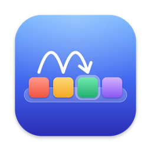
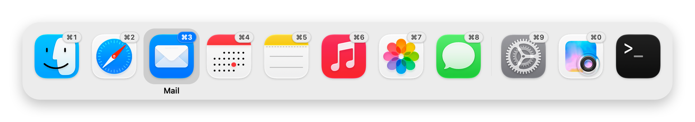

<p align="center">
  
</p>

<h1 align="center">Dockstep</h1>

<p align="center">
  <strong>⌘⇥ in Dock order for macOS</strong><br>
  <a href="https://github.com/akitogo/dockstep/releases/latest">Download</a> ·
  macOS 13 or later · Apple silicon and Intel · Free and open source
</p>

<picture>
  <source media="(prefers-color-scheme: dark)" srcset="docs/switcher-dark.png">
  
</picture>

A small menu bar app that makes **⌘⇥ go through your apps in Dock order** instead of
"most recently used". Everything else about the Dock and the switcher stays as you know it.

Order shown in the switcher:

1. Finder (always first, as in the Dock)
2. Apps kept in your Dock, in the order you arranged them (rearranging the Dock takes effect immediately)
3. A divider, then other running apps in the order you opened them

## Install

Requires macOS 13 or later, on Apple silicon or Intel.

1. Download `Dockstep-<version>.zip` from the [latest release](https://github.com/akitogo/dockstep/releases/latest).
2. Unzip it and move **Dockstep** to your **Applications** folder.
3. Open it. Dockstep isn't notarized by Apple yet, so the first time macOS says it can't
   verify the app. Click **Done**, open **System Settings › Privacy & Security**, scroll down,
   click **Open Anyway** next to the Dockstep message and confirm. You only need to do this once.
   (Or in Terminal: `xattr -dr com.apple.quarantine /Applications/Dockstep.app`)
4. A short welcome message explains the keys; the settings are in its menu bar icon.

Dockstep needs no Accessibility or other permissions. To start it automatically, turn on
**Open at Login** in its menu bar icon.

### Build it yourself

With the Xcode Command Line Tools (`xcode-select --install`):

```bash
./build.sh --install
```

This builds `build/Dockstep.app`, copies it to `/Applications` and starts it.

### Making a release

1. Set the new version in `VERSION` and add an entry to `CHANGELOG.md`.
2. Run `./build.sh --release`. It builds for Apple silicon and Intel, signs with your
   Developer ID certificate, notarizes with Apple (using the notarytool keychain profile
   `dockstep`) and writes `dist/Dockstep-<version>.zip`.
3. Tag the commit (`v<version>`) and attach the zip to a GitHub release.

## Using it

Hold ⌘ and:

| Key | Does |
| --- | --- |
| Tab / ⇧Tab | next / previous app |
| ← / → | move left / right |
| 1 … 9, 0 | jump straight to that position and switch |
| Return | switch now |
| Q | quit the selected app |
| H | hide / show the selected app |
| Esc | cancel |

Release ⌘ to switch to the selected app. You can also hover and click with the mouse.

## Settings (menu bar icon)

- **Use Dock order for ⌘⇥**: turn Dockstep off without quitting (the built-in switcher comes back).
- **First ⌘⇥ press selects**
  - *the next app after the current one* (default): one ⌘⇥ moves one step right in the Dock.
  - *the first app in the Dock*: each app is always the same number of Tab presses away.
- **Also show Dock apps that aren't running**: keeps the positions fixed even when apps
  are closed. Picking one opens it.
- **Position numbers**: for the ⌘-number jump, shown as a small *⌘3 badge* on each icon's
  top-right corner (default, takes no extra space), as a row *above* or *below* the icons,
  *hidden* (the ⌘1…⌘0 shortcuts keep working) or *off* (no numbers and no ⌘1…⌘0).

Dockstep is in English and German; it follows the language set in
System Settings › General › Language & Region. Translations are in
`Resources/<language>.lproj/Localizable.strings`, with the English text as the key.

## How it works

- The built-in ⌘⇥ is switched off with the private WindowServer function
  `CGSSetSymbolicHotKeyEnabled`, the same approach [AltTab](https://github.com/lwouis/alt-tab-macos) uses,
  and ⌘⇥ is registered as a normal global hotkey instead.
- The Dock order is read from the Dock's own preferences (`com.apple.dock` → `persistent-apps`).
- Releasing ⌘ is detected by checking the modifier keys while the switcher is open.

## If ⌘⇥ ever stops working

Dockstep turns the built-in switcher back on when you quit it, when it is ended from
Activity Monitor and when it crashes. Only a forced `kill -9` skips that. In that case, run:

```bash
/Applications/Dockstep.app/Contents/MacOS/Dockstep --restore-cmd-tab
```

## Developer commands

```bash
build/Dockstep.app/Contents/MacOS/Dockstep --print-order          # list apps in switcher order
build/Dockstep.app/Contents/MacOS/Dockstep --print-order --all    # include Dock apps that aren't running
build/Dockstep.app/Contents/MacOS/Dockstep --snapshot panel.png   # render the panel to an image (--demo: Apple apps, --framed: with shadow)
                                                                # (--dark, --numbers badge|top|bottom|hidden|off)
build/Dockstep.app/Contents/MacOS/Dockstep --print-menu           # print the menu as text
build/Dockstep.app/Contents/MacOS/Dockstep --print-menu -AppleLanguages '(en)'   # …in another language
```

The README screenshots are rendered with standard Apple apps, so they never show your own:

```bash
B=build/Dockstep.app/Contents/MacOS/Dockstep
$B --snapshot docs/switcher-light.png --demo --framed --numbers badge -AppleLanguages '(en)'
$B --snapshot docs/switcher-dark.png --demo --framed --numbers badge --dark -AppleLanguages '(en)'
```

The app icon is drawn in code. To change it, edit `Tools/make-icon.swift` and regenerate
`Resources/AppIcon.icns`:

```bash
swiftc Tools/make-icon.swift -o /tmp/make-icon && /tmp/make-icon Resources/AppIcon.icns
```

## License

Copyright © 2026 akitogo

Dockstep is free software: you can use, study, share and change it under the terms of the
[GNU General Public License v3.0](LICENSE). If you distribute it, modified or not, you must
make the complete source code available under the same license.
